# Avo 植物管家 · AVO PLANT MANAGER

家庭种植用的植物健康诊断与嫁接辅助 App。拍一张叶子照片，它会告诉你这是什么植物、有没有病、能不能嫁接，然后把每次检查记进档案，慢慢看它恢复。课程原型，独立完成。

吉祥物是只叫 Avo 的小鳄鱼，所以中文叫「Avo 植物管家」，英文 AVO PLANT MANAGER。

识别全部跑在本机，不调用云端视觉接口。**这是教学原型，不是生产级诊断工具，结果不构成农业建议。**

## 能做什么

**诊断 · 拍照识病。** 拍照或从相册选一张，模型给出物种和病害结论、置信度、处理建议。一次识别可以一键记进对应植物的健康档案。覆盖番茄、苹果、马铃薯、葡萄、玉米、辣椒、草莓、蓝莓、樱桃、桃、橙子、树莓、大豆、南瓜共 14 种作物。

**嫁接 · 先算合不合，病了还能救。** 单独入口，填接穗和砧木品种（也可以让模型按识别出的作物推断），走兼容性规则判断能不能接、怎么接、要注意什么。置信度不够时会要求重拍。

**识别 × 嫁接联动。** 这是本项目的核心巧思：细菌性、萎蔫类病害的病原在土壤里，打药治标不治本，生产上的标准恢复手段是换抗病砧木嫁接。因此当识别命中这类病害时，结果页不只给建议，还会给出一份砧木方案——推荐 2~3 个生产上验证过的抗病砧木（番茄配托鲁巴姆、柑橘配枳、葡萄配贝达等，共 9 个砧木品种内置在品种库），一键带着预填的接穗 / 砧木跳进嫁接初筛试算兼容性。这类生产验证过的组合在评分时有砧木亲和加成，同科异属不再被机械扣分；番茄×马铃薯这类同科异属组合还配了趣味知识卡。

**养 · 健康追踪。** 每株植物建一份追踪档案，月历打卡、拍照记录、置信度趋势曲线，自动判定好转 / 恶化 / 持平 / 波动。历史记录能点开看当时的照片和诊断。首页「今日待办」按植物列出该拍照、该复查、该建追踪的事项，点掉一项有满屏飘落的点赞反馈。

**我的花园 · 一片地。** 植物不是列表，是种在一片草坡上：14 种作物有各自的插画，按品种落在地上，位置由植物 id 决定，刷新不会重新洗牌。鼠标悬停（手机上是点击）弹一张卡片，写清它叫什么、长什么样、健康状况、什么时候种的。点开进植物档案。

**发现 · 种植社区。** 小红书式双列瀑布流。发帖支持多图（最多 9 张）、标签（最多 6 个）、公开或仅自己可见；能点赞、评论、收藏、关注。被管理员下架的帖子会进作者自己的草稿箱，改完能重新发。

**个人资料 · 账号。** 注册登录、改昵称、六款 Avo 造型或上传自己的照片当头像、草稿箱、修改密码（在「编辑资料」里）、退出登录。

**管理后台**（`/admin/`）。数据看板、用户增删与设管理员、帖子下架（附系统通知）与恢复、删评论。

## 界面

手机端 390×844。点击图片可看原图。

| 首页 | 诊断 | 完成待办 |
|:---:|:---:|:---:|
| 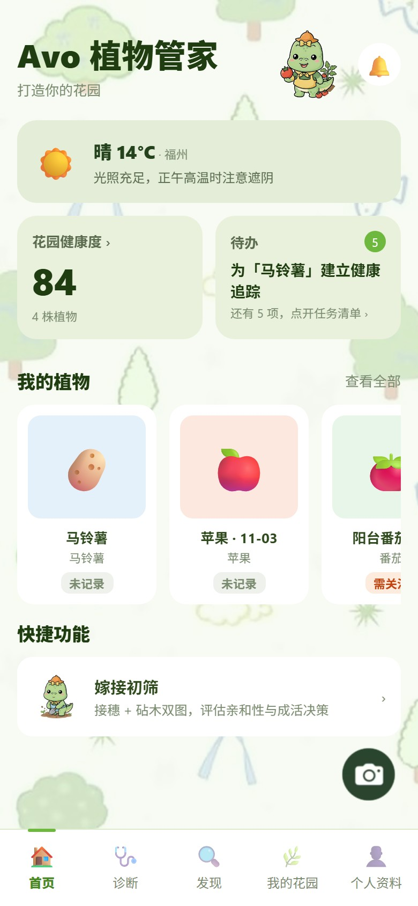 | 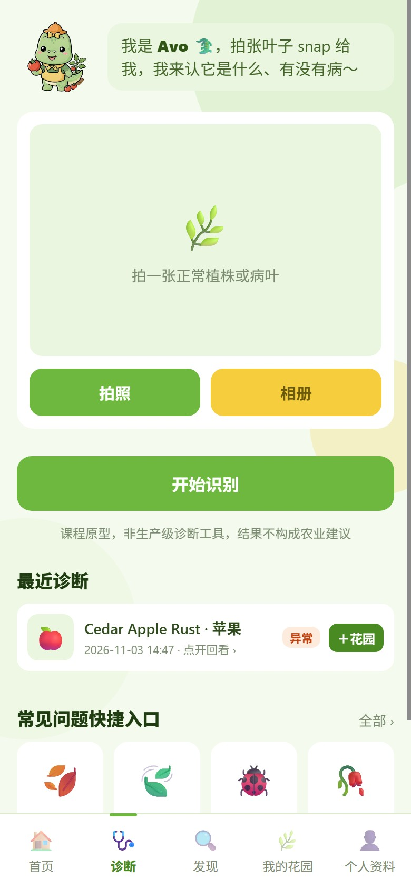 | 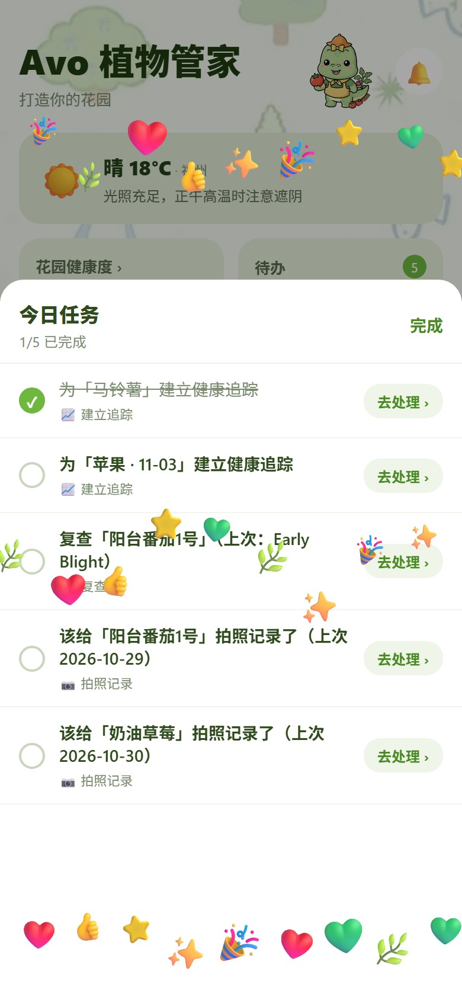 |
| **发现** | **我的花园** | **个人资料** |
| 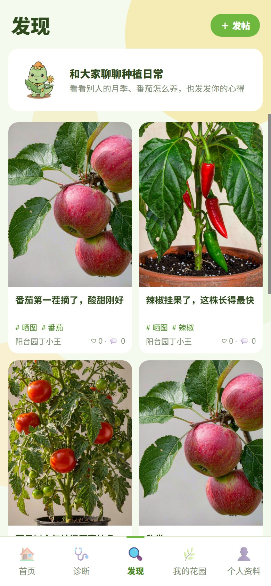 | 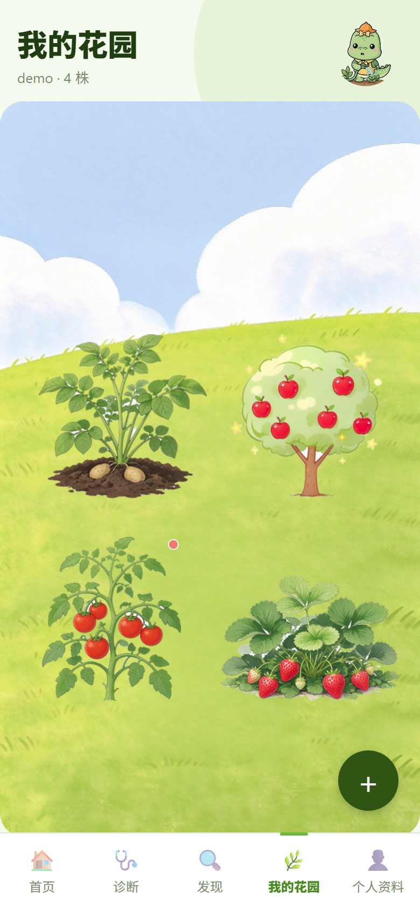 | 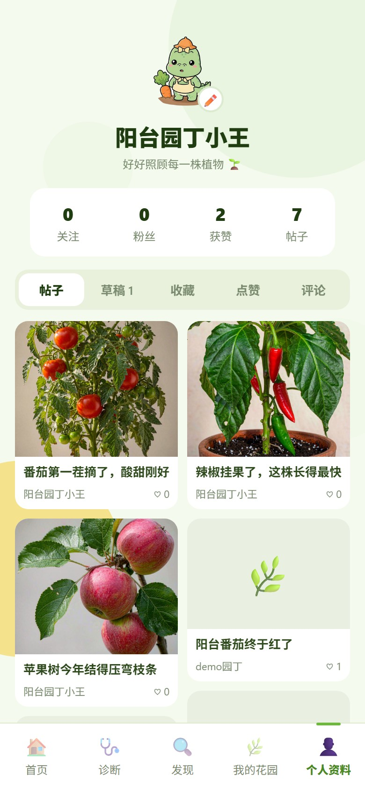 |
| **健康追踪** | **发笔记** | **帖子详情** |
| 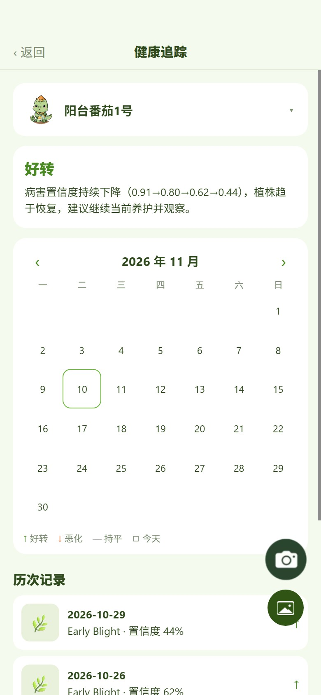 | 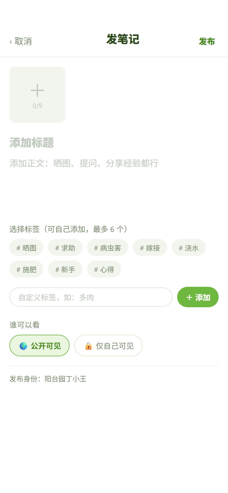 | 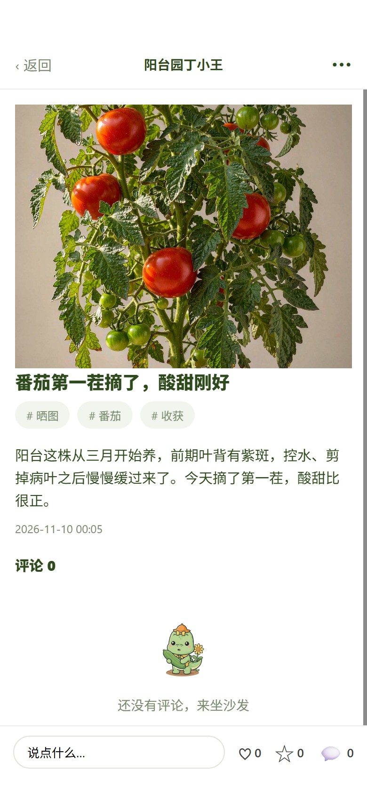 |
| **作者管理** | **登录注册** | **编辑资料** |
| 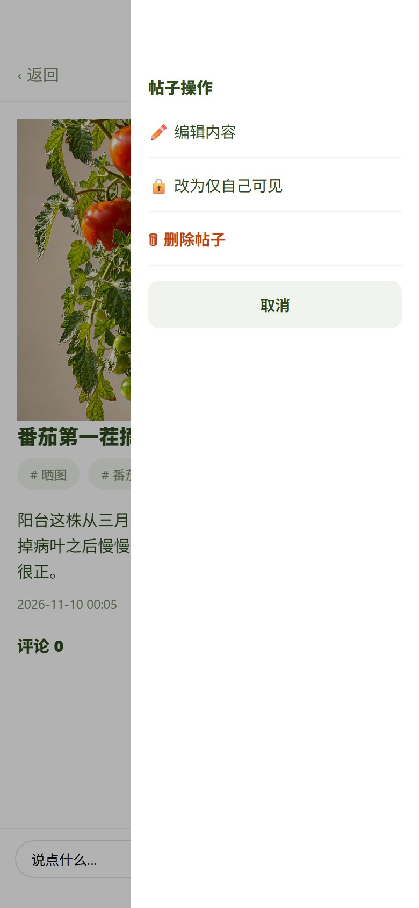 | 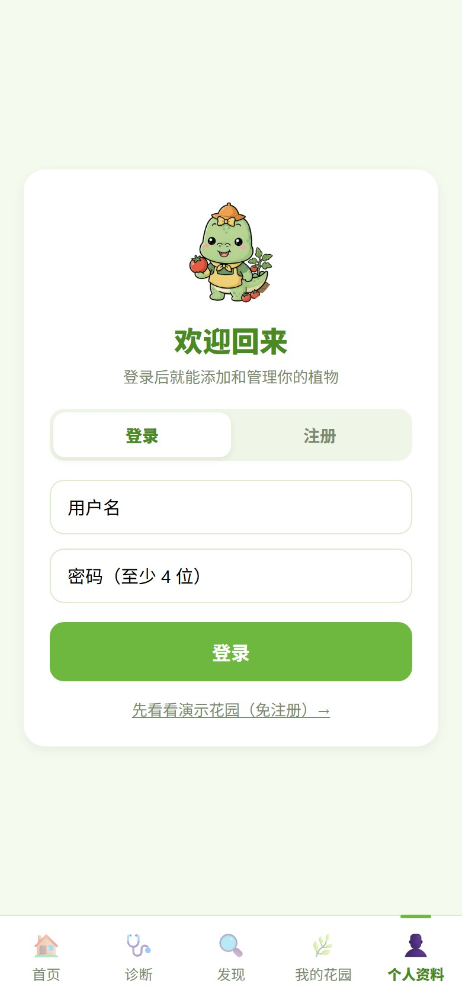 | 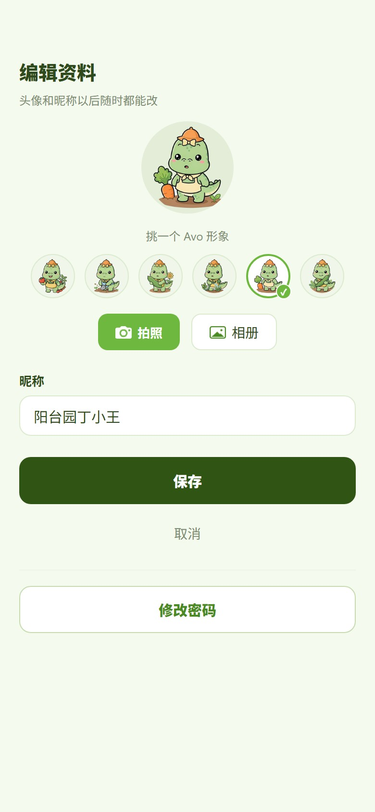 |

首页是天气、花园健康度、今日待办和我的植物，右下角相机直达诊断。勾掉一项待办会放满屏点赞，爱心、星星、大拇指、彩带从顶部错落飘落，约 6 秒散去，完成状态存在浏览器本地。

花园是种着 14 种作物插画的草坡，植株按金字塔排布，最多 7 株一块地；鼠标悬停（手机上是点击）能看到它叫什么、长什么样、健康状况和种植日期。发现页是双列瀑布流，封面统一竖版 3:4；帖子详情页右上角「⋯」是作者自己的编辑、改可见范围和删除。编辑资料里能换六款 Avo 造型或上传照片，底部是修改密码入口。桌面端宽度 ≥1024 时换成左侧导航，首页变两栏。

## 技术选型

**前端**：Expo React Native（SDK 51）+ React。同一套代码打包 Android APK，也 `expo export` 出 Web 静态页。桌面端做了等比缩放（`lib/webScale.js`），布局按 1440 宽设计，整页 `transform: scale()` 适配大屏，手机上 s=1 完全无感。

**后端**：FastAPI + Uvicorn + SQLite（单文件 `backend/data/app.db`），跑在 8010。

**视觉模型**：PlantVillage MobileNetV2（实验室病害 38 类）、PlantDoc EfficientNetV2（真实场景病害 28 类）、PlantNet-300K ResNet18（物种兜底）。权重本地化，运行期离线 CPU 推理。

**部署**：Docker，仓库根有 `render.yaml` 可一键在 Render 建服务，构建期把模型下进镜像。

## 识别是怎么判的

**一张图切六个视角。** 原图、中心 70% 裁片、2×2 六成网格，共 6 片分别推理。排名用跨视角平均分（稳），展示的置信度取最佳单视角峰值（不失真）。

**作物冲突听 PlantDoc 的。** PlantVillage 是实验室叶片图训练的，会在真实照片上高置信出错——比如把番茄判成葡萄黑腐、置信度 0.929。所以作物不一致时以 PlantDoc 为准（`PD_AUTHORITY=0.25`），用真实场景模型纠偏。

**两档门控。** `DISEASE_GATE=0.65` 直接采信；`0.30` 到 `0.65` 之间照采但标低置信；低于 `0.30` 要求重拍。嫁接侧另一套：`retake_confidence=0.30` 才要求重拍，`low_confidence_hint=0.60` 出结论加黄条提示。规则在 `config/fusion_rules.json`，改完要重启后端。

**物种兜底模型不可靠。** PlantNet-300K 在真实照片上容易乱报且极度自信，只当兜底、不单独采信。根治得靠真实照片微调，那是另一件事。

## 接口一览

后端统一 `:8010`，管理接口前缀 `/api/admin`。

**识别**：`POST /analyze`（`task_type` 分诊断 / 嫁接 / 物种 / 纯拍照四种场景）、`GET /varieties`、`GET /care/{crop}`

**认证**：`POST /auth/register`、`POST /auth/login`、`POST /auth/demo`（一键体验号）、`POST /auth/logout`、`GET /auth/me`、`POST /auth/change-password`、`POST /auth/change-username`

**花园**：`GET /garden`、`GET /garden/{plant_id}`、`POST /garden`、`POST /garden/{plant_id}/photo`、`DELETE /garden/{plant_id}`、`POST /garden/{plant_id}/track`（建或复用追踪，会去重）

**追踪**：`POST /tracks`、`GET /tracks`、`GET /tracks/{track_id}`

**首页 / 天气**：`GET /home`（今日概览 + 我的植物）、`GET /weather`（Open-Meteo 免 key + IP 定位，失败回退演示数据）、`GET /todos`、`GET /diagnoses/recent`、`GET /diagnoses/{id}`

**社区**：`GET /posts`、`POST /posts`、`GET /posts/{id}`、`PUT /posts/{id}`、`DELETE /posts/{id}`、`PATCH /posts/{id}/visibility`、`GET /drafts`、评论、点赞、收藏

**用户 / 社交**：`GET /profile`、`POST /profile/update`（昵称 + 头像，头像压到 256px）、`POST /users/{id}/follow`、通知相关三个接口

**管理端**（需 role=admin）：`GET /api/admin/stats`、用户列表 / 删除 / 改角色、帖子列表 / 下架 / 恢复、删评论

## 跑起来

### 一键起（推荐）

```bash
node scripts/start_servers.js
```

脚本先探 3000 和 8010，没在跑的用独立进程拉起来，已经在跑的跳过。然后打开 `http://localhost:3000`。

### 手动起后端

```bash
cd backend
IDENTIFIER=model uvicorn app.main:app --host 0.0.0.0 --port 8010
```

`http://localhost:8010/health` 自检，`http://localhost:8010/docs` 是自动生成的接口文档。`backend/models/` 里只内置了物种模型（约 45MB）；两个病害模型首次启动从 HuggingFace 下载缓存，国内网络不通就加 `HF_ENDPOINT=https://hf-mirror.com`。

### 手动起前端网页版

```bash
cd frontend
npx expo export --platform web   # 产物在 frontend/dist/
node serve.js                    # http://localhost:3000
```

网页端的 API 地址固定是 `http://localhost:8010`（`frontend/lib/config.js`）。注意 `expo export` 会把 `app.json` 里的 `extra.apiUrl` 烤进网页包，所以改完后端地址后要重新打包，不然会连不上。

### 真机 / 模拟器

```bash
cd frontend
npm install
npx expo start        # 真机用 Expo Go 扫码
```

真机连电脑上的后端要把 `app.json` 的 `extra.apiUrl` 改成局域网 IP。

## 账号

**管理员**：`admin` / `admin123`，能用后台全部功能。公开部署前记得用环境变量 `ADMIN_USERNAME` / `ADMIN_PASSWORD` 改掉。

**体验号**：首页或登录页的「先看看演示花园」，服务端自动建一个带植物、带诊断记录、带帖子的演示账号，不用注册。

**普通账号**：自己注册，用户名和密码都行，密码至少 4 位。

## 自测

```bash
node scripts/test_backend.js 3   # 主流程 84 项，跑三轮，约 40 秒
node scripts/test_admin.js       # 管理接口 25 项
```

第一个脚本每轮用随机账号注册、跑完全流程、自己清理；覆盖认证、权限隔离、花园增删改、图片上传、社区全套、私密帖隔离、4 个识别场景。第二个要提权才能测管理接口，脚本直接用 sqlite 把临时账号提成 admin，跑完在 `finally` 里降级删号。

识别是走真模型的，单图诊断 0.8–3 秒，嫁接双图 1.6–5.5 秒，跑第二轮之后会明显变快。

**没覆盖的**：并发写入、大文件上传、长时间运行的内存增长，以及识别**准不准**——脚本只验证接口返回结构合理，准确率评估是另一套离线评测的事。

## 目录

```
├── backend/
│   ├── app/            FastAPI 源码（main 路由 / fusion 融合决策 / predict 推理 / db 数据层 / weather 天气 / care 养护建议）
│   ├── admin/          管理后台静态页，挂在 /admin/
│   ├── models/         物种模型权重
│   ├── data/           SQLite 与上传的图片（不入库）
│   └── tests/
├── frontend/
│   ├── screens/        五个 tab：Home / Identify / Community / Garden / Profile，加 Login、PlantDetail、Track、Analyze
│   ├── components/     GardenLawn（草坡）/ FadeUp / TapCard / Skeleton / SmartImage / VarietyPicker
│   ├── lib/            api / config / theme（设计 token）/ crops（品种与外观描述）/ avatar / plantStatus / webScale / time
│   ├── assets/         吉祥物、14 种作物插画、背景图
│   └── serve.js        网页静态服务，3000
├── config/             fusion_rules.json（融合门控）/ varieties.json（品种库）
├── scripts/            start_servers / test_backend / test_admin / cut_plants（作物插画抠图）
├── docs/screenshots/   README 用的界面截图
├── prototype/          原型与吉祥物源文件
└── test_samples/       自测用的植物照片
```

## 打包 APK

```bash
cd frontend
eas build --platform android --profile preview
```

`frontend/eas.json` 的 preview 配了 `buildType: "apk"`，产物可直接安装。前提是已 `eas init` 并登录 Expo 账号。

打包前一定先把 `app.json` 的 `extra.apiUrl` 换成后端 HTTPS 地址，否则真机连不上本地后端。

## 部署后端

`backend/DEPLOY.md` 有完整步骤，仓库根的 `render.yaml` 是 Blueprint，连上 GitHub 仓库就自动建服务。构建期把三个模型下进镜像，运行期离线。

## 几个已知限制

**模型许可证**：物种模型 PlantNet-300K 是 Apache-2.0；两个病害模型标的是 `other`，课程自用没问题，公开发布前得单独确认授权。

**数据不持久**：免费托管方案的磁盘是临时的，SQLite 和上传图片会在实例重启后丢。空库启动会自动种演示帖和演示花园。

**上传图片存在本地**：`backend/data/uploads/`，上云后建议换对象存储。

**定位**：Open-Meteo 拿天气、ipwho.is 按出口 IP 定位。浏览器能拿到 GPS 坐标时前端会传 `?lat=&lon=` 过来，精度更高。没有可用的反向地理编码服务（nominatim、bigdatacloud 都不通），所以坐标离 IP 定位超过 50km 就只显示「当前位置」。
