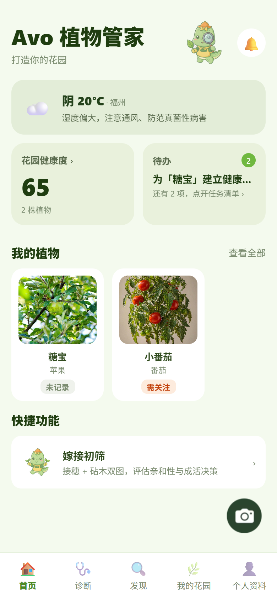
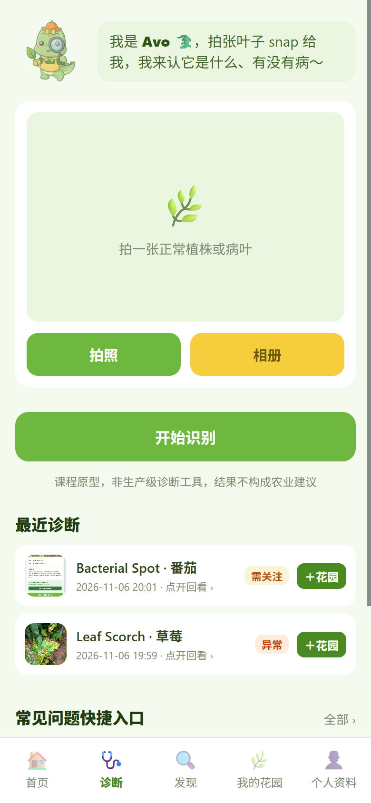
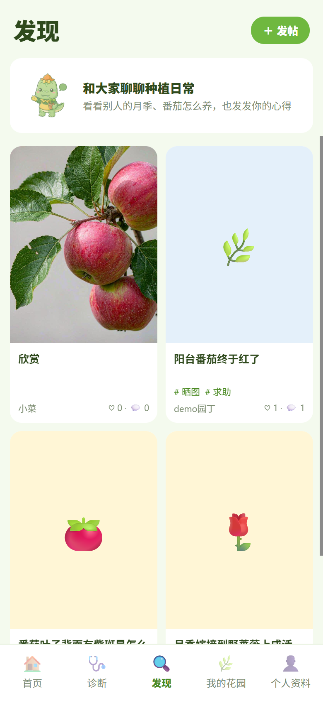
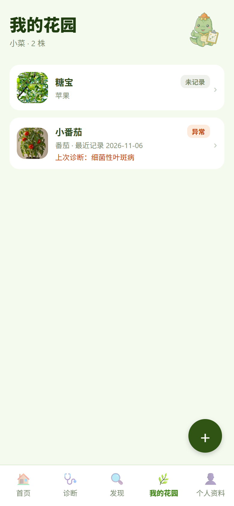
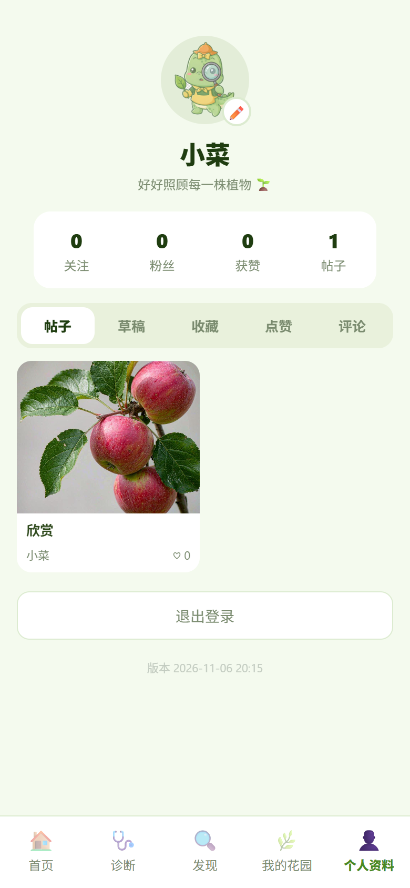

# GraftCheck · 植物健康与嫁接辅助 App

一个面向家庭种植爱好者的课程原型：拍一张植物照片，帮你识别物种/病害、判断能不能嫁接、追踪恢复趋势，还能在社区发帖交流。后端离线跑视觉模型，前端用 Expo（安卓 + Web）。

定位：**课程原型，非生产级诊断工具**，结果不构成农业建议。

## 功能一览

- **诊断**：拍照识别植物物种与病害（支持番茄、苹果、葡萄、辣椒等 14 种作物），给出处理建议，可一键记入植物档案
- **健康追踪**：为每株植物建立追踪档案，月历打卡 + 拍照记录 + 置信度趋势曲线（好转 / 恶化 / 持平 / 波动）
- **我的花园**：植物档案管理，历次诊断记录可回看照片与详情
- **发现**：小红书式种植社区——发帖（多图 + 标签 + 可见范围）、点赞、评论、关注
- **个人资料**：登录注册、头像昵称、草稿箱
- 另有管理员后台（用户管理、帖子下架/恢复）：`/admin/`

## 技术要点

- **双病害模型融合**：PlantVillage MobileNetV2（实验室图）+ PlantDoc EfficientNetV2（真实图），每张图做 6 视角裁片投票，跨视角取峰值排名
- **置信度门控**：两档门控直采 / 低置信提示，双模型分歧时按峰值置信度仲裁，避免实验室模型高置信误判带偏结果（规则见 `config/fusion_rules.json`）
- **纯 CPU 离线推理**：模型权重本地化，运行期不依赖网络；桌面端 Web 整体等比缩放适配

## 界面展示

| 首页 | 诊断 | 发现 |
|:---:|:---:|:---:|
|  |  |  |
| **我的花园** | **个人资料** | |
|  |  | |

## 技术栈

- 前端：Expo React Native（SDK 51），可打包安卓 APK，也可导出 Web 静态页
- 后端：FastAPI + SQLite，三个图像模型（PlantVillage 病害 / PlantDoc 真实病害 / PlantNet 物种），权重随 Docker 镜像内置，运行期离线

## 本地跑起来

后端（需要 Python 3.11 + 已装依赖的虚拟环境）：

```
cd backend
IDENTIFIER=model uvicorn app.main:app --host 0.0.0.0 --port 8010
```

打开 `http://localhost:8010/health` 自检，或 `http://localhost:8010/test/live_test.html` 用网页测试台。
（本机 8000 端口被占用，本地演示统一用 8010。）

说明：`backend/models/` 里只内置了物种模型（PlantNet，45MB）；两个病害模型首次启动会从 HuggingFace 自动下载缓存，国内网络不通时加环境变量 `HF_ENDPOINT=https://hf-mirror.com`。

前端（需要 Node 22+）：

```
cd frontend
npm install
npx expo start        # 真机用 Expo Go 扫码；浏览器预览用网页模式
```

网页版构建 + 本地预览（不依赖 expo 开发服务器）：

```
cd frontend
npx expo export --platform web   # 产物在 frontend/dist/
node serve.js                    # 打开 http://localhost:3000
```

前端 API 地址：网页版固定 `http://localhost:8010`（`frontend/lib/config.js`，已禁用浏览器翻译干扰）；真机调试改 `LAN_API_URL` 为电脑局域网 IP。

## 仓库结构

```
backend/        FastAPI 后端（app/ 源码、models/ 模型权重、DEPLOY.md 部署说明）
frontend/       Expo 前端（screens/ 页面、lib/ 工具、assets/ 图标）
config/         病害识别融合规则（fusion_rules.json，改后需重启后端）
prototype/      原型设计与吉祥物源文件
test_samples/   自测用的示例植物照片
deploy/         部署相关说明
render.yaml     Render 部署 Blueprint
需求分析文档_v2.1_安卓版.md
```

## 部署后端（拿 HTTPS 地址）

后端用 Docker 一键部署到 Render（免费实例），详见 `backend/DEPLOY.md`。仓库根目录的 `render.yaml` 已写好 Blueprint，连接 GitHub 仓库即自动建服务。构建期把三个模型下进镜像，运行期离线。

重点：打包 APK / 发正式版前，必须先把 `frontend/app.json` 里的 `extra.apiUrl` 改成后端 HTTPS 地址，然后重新 `eas build`，否则真机连不上本地后端。

## 打包安卓 APK

```
cd frontend
eas build --platform android --profile preview
```

`frontend/eas.json` 的 preview 已设 `buildType: "apk"`，产物是可直接安装的 APK（不是 AAB）。前提：已 `eas init` 并登录 Expo 账号。

## 注意事项

- **模型许可证**：物种模型 PlantNet-300K 是 Apache-2.0；两个病害模型许可证为 `other`，课程自用无碍，公开发布前请另行确认授权。
- **数据持久化**：免费托管磁盘不持久，SQLite 与上传图片会在实例重启后丢失。演示前现场发几条种子数据即可（空库会自动种演示帖与演示花园）。
- **管理员账号**：默认 `admin / admin123`，任何公开部署请通过环境变量 `ADMIN_USERNAME` / `ADMIN_PASSWORD` 改掉。
- **上传图片**：发帖/头像/追踪图片存在后端本地 `backend/data/uploads/`，上云后建议接对象存储做持久化。
